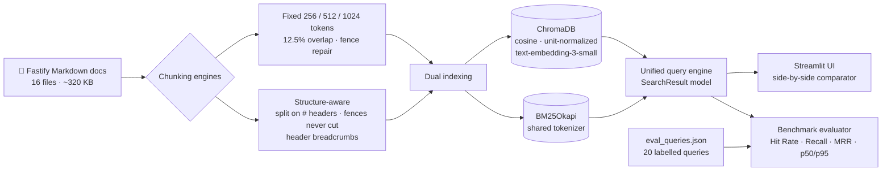

# 🔎 Semantic Search Benchmarker (SearchWorkbench)

A search engine over the **Fastify reference documentation**. It compares **BM25 keyword search** with **dense vector search** (OpenAI `text-embedding-3-small` + ChromaDB) across **four chunking strategies**, and measures them with an automated IR benchmark: Hit Rate@K, Recall@K, MRR@K and latency.

- **Live demo:** https://semantic-search-benchmarkerbranchmain-psxbqbkugfuyv6ksp33pzp.streamlit.app
- **Video walkthrough:** https://youtu.be/aAIr6iApzE4

## Architecture



## Project structure

```
semantic-search-benchmarker/
├── corpus/fastify/              # 16 Fastify reference pages (MIT, see LICENSE-fastify)
├── data/
│   ├── eval_queries.json        # 20 labelled queries (10 exact-keyword, 10 conceptual)
│   └── embeddings_cache.npz     # cached embeddings (built once, committed)
├── scripts/build_embeddings.py  # one-time embedding of every chunk + query
├── src/
│   ├── chunking.py              # FixedSizeChunker, StructureAwareChunker, DocumentChunk
│   ├── embeddings.py            # OpenAI embedder, on-disk cache, unit normalization
│   ├── indexer.py               # ChromaDB dense index + BM25 index, shared tokenizer
│   ├── search.py                # SearchEngine + SearchResult
│   ├── benchmarker.py           # Hit Rate, Recall, MRR, latency, failure analysis
│   └── app.py                   # Streamlit dashboard
└── tests/                       # chunking, retrieval and metric-math tests
```

## Installation (uv, Python 3.11+)

```bash
git clone https://github.com/patie03/semantic-search-benchmarker.git
cd semantic-search-benchmarker
uv sync
cp .env.example .env                        # add your OPENAI_API_KEY
uv run python scripts/build_embeddings.py   # one time, costs < $0.01
```

## Execution commands

```bash
uv run streamlit run src/app.py   # dashboard → http://localhost:8501
uv run pytest -v                  # test suite (uses the cached embeddings, no API calls)
docker compose up --build         # container alternative
```

## Corpus & evaluation dataset

**Corpus:** 16 pages of the [Fastify](https://github.com/fastify/fastify) `docs/Reference` folder (Server, Routes, Hooks, Reply, Request, Errors, Validation-and-Serialization, Plugins, Decorators, Logging, Lifecycle, ContentTypeParser, Encapsulation, HTTP2, Middleware, Warnings). That's about 320,000 characters, or roughly 100 pages, of dense API text with many code blocks and an error-code table. It's MIT licensed, and the license is included in `corpus/fastify/`.

**Evaluation set:** `data/eval_queries.json` has 20 queries:
- **10 exact-keyword queries:** error codes and option names, e.g. `FST_ERR_HOOK_TIMEOUT`, `return503OnClosing`
- **10 conceptual queries** that use different words from the docs, e.g. *"How can I stop huge uploads from overwhelming my machine?"* (the answer is the `bodyLimit` section)

Each label names the **source file and an exact answer sentence** (`answer_span`), not a chunk number. For each chunking strategy, a chunk is relevant if its source character range overlaps that sentence. The same labels therefore work for 256-token, 1024-token and header-based chunks, with no index leakage.

## Chunking strategies

| Strategy | How | Chunks | Avg tokens |
|---|---|---|---|
| Fixed 256 | tiktoken windows, 32-token overlap, code fences re-opened/closed | 361 | ~250 |
| Fixed 512 | 64-token overlap | 185 | ~500 |
| Fixed 1024 | 128-token overlap | 95 | ~990 |
| Structure-aware | split on `#`–`####`, never inside a fence, `[file \| breadcrumb]` prefix, max 512 tokens (a code block that's too long stays whole) | 318 | ~262 |

## Empirical benchmark findings

Measured on the 20 labelled queries, K = 3/5/10, with query embeddings cached (latency = index lookup only).

| Configuration | Chunks | Avg tokens | Hit@3 | Hit@5 | Hit@10 | Recall@5 | MRR@5 | Hit@5 exact | Hit@5 conceptual | p50 ms | p95 ms |
|---|---|---|---|---|---|---|---|---|---|---|---|
| BM25 (baseline, structure chunks) | 318 | 262 | 0.70 | 0.75 | 0.80 | 0.75 | 0.64 | **1.00** | 0.50 | **0.48** | **0.78** |
| Dense · fixed 256 | 361 | 252 | 0.70 | 0.70 | **0.90** | 0.68 | 0.43 | 0.70 | 0.70 | 1.50 | 2.73 |
| Dense · fixed 512 | 185 | 490 | 0.40 | 0.60 | 0.70 | 0.60 | 0.33 | 0.50 | 0.70 | 1.76 | 2.17 |
| Dense · fixed 1024 | 95 | 947 | 0.60 | 0.70 | 0.80 | 0.65 | 0.49 | 0.70 | 0.70 | 1.64 | 1.94 |
| **Dense · structure-aware** | 318 | 262 | **0.75** | **0.85** | 0.85 | **0.85** | **0.65** | 0.90 | **0.80** | 1.89 | 3.19 |

**Reflection.** The two retrievers fail in opposite places. On exact identifiers (`FST_ERR_HOOK_TIMEOUT`, `return503OnClosing`) BM25 found the answer in the top 5 for **10 of 10** queries, because a rare token gets a very high IDF weight. Dense search sometimes ranked a similar-looking error code above the right one: `FST_ERR_DEC_ALREADY_PRESENT` came 4th, and `reply.hijack()` fell out of the top 10 for structure chunks. On paraphrased questions the picture flips. *"How can I stop huge uploads from overwhelming my machine?"* shares **zero** keywords with the `bodyLimit` section, and BM25 missed it completely, while dense search found it at rank 1 with structure-aware and 1024-token chunks (the 256- and 512-token windows split the section and missed it). Overall, BM25 managed only 0.50 Hit@5 on conceptual queries against 0.80 for dense structure-aware chunks. This argues for **hybrid retrieval** (for example, reciprocal-rank fusion of both lists) rather than picking one engine.

Chunking mattered as much as the engine. Structure-aware chunks gave the best Hit@5 (0.85) and MRR@5 (0.65), because each chunk is one coherent section with its header breadcrumb (`Server > Factory > bodyLimit`) embedded in the text. Fixed windows are blind to section boundaries. 512-token windows were the worst (MRR 0.33): they are big enough to mix two or three unrelated options into one vector, but not big enough to always contain the whole section. 1024-token windows recovered some Hit Rate simply because a huge chunk is more likely to *contain* the answer, but the user then has to read ~950 tokens to find it. 256-token windows reached the best Hit@10 (0.90) but ranked the answer lower (MRR 0.43). Latency was not a deciding factor at this scale: every configuration answered in under 4 ms at p95, BM25 was about 3× faster than Chroma, and in production the OpenAI embedding call (~100–300 ms) would dominate dense latency. One query (*"Why does attaching a shared object to every incoming request crash at startup?"*) was missed by every configuration. It's a good candidate for query rewriting or hybrid search.

## AI audit log summary

The code was generated with Claude from the course prompt, then audited and tested. Full details and diffs are in [`ai_prompt_log.md`](ai_prompt_log.md).

1. **Structure chunker merged sections and lost breadcrumbs.** Fixed so it only merges bare headers, and the deepest header is used for the breadcrumb.
2. **Fixed chunker cut code fences.** 178 of 361 chunks were affected. Fixed with fence repair; the raw token ranges are kept for the overlap test.
3. **Dead `and False` branch in the fence-state helper.** Replaced it with a single fence-parity function.
4. **Verified correct:** span-based ground truth (no index leakage), distance → similarity conversion, symmetric BM25 tokenization, and MRR = 0 on a miss.
